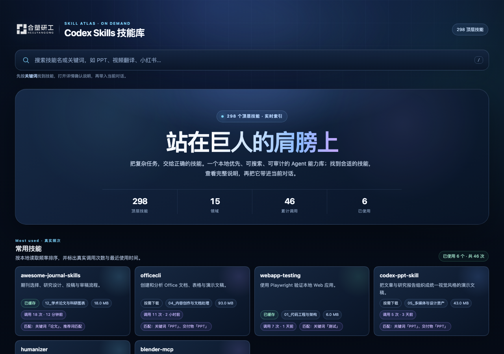
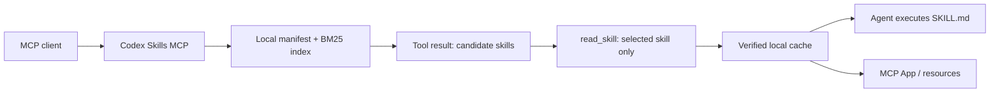

<p align="center">
  <picture>
    <source media="(prefers-color-scheme: dark)" srcset="brand/logo-white.png">
    
  </picture>
</p>

<h1 align="center">Codex Skills MCP</h1>

<p align="center">
  <strong>Local-first, on-demand skill discovery for MCP clients.</strong><br>
  让 Agent 只加载真正需要的专业技能，而不是把整套技能库塞进上下文。
</p>

<p align="center">
  
  
  
  
</p>

Codex Skills MCP is a production-oriented Model Context Protocol server and an
installable Codex/ChatGPT desktop plugin for a continuously updated expert-skill
library. It indexes a lightweight catalog, searches locally, downloads selected
skills on demand, verifies every file, and keeps the working set auditable on
disk.

**Available as:** ChatGPT/Codex desktop plugin · standalone stdio MCP server ·
self-hosted Streamable HTTP MCP server.



## Why Codex Skills MCP

| Capability | What it means |
|---|---|
| **Progressive loading** | Search costs tokens; full instructions and assets are downloaded only after a skill is selected. |
| **Small model surface by default** | Standard MCP clients receive 8 focused tools. ChatGPT/Codex MCP Apps hosts can opt into the 22-tool UI surface. |
| **Integrity-first downloads** | Known files are checked against size and Git blob SHA before entering the cache. |
| **Local-first cache** | Skills materialize under `~/.codex-skills-cache` and remain reusable across sessions. |
| **Resilient installation** | Direct GitHub, the official read-only mirror, jsDelivr and fallback mirrors can race without exposing credentials. |
| **Agent keeps judgment** | Search results are candidates, not mandatory loading instructions. The agent can use none, one, or several skills. |

## Quick Start

Requirements: Node.js 22 or newer.

```bash
npx -y codex-skills-mcp@beta
```

The current `main` line is **1.5.0-beta.16**. Use the `beta` dist-tag to test
the features described here. The `latest` tag still points to stable 1.4.2 and
may lag behind the current MCP Apps and host-detection work.

### Codex

```bash
codex mcp add codex-skills -- npx -y codex-skills-mcp@beta
```

Or add this to `~/.codex/config.toml`:

```toml
[mcp_servers.codex-skills]
command = "npx"
args = ["-y", "codex-skills-mcp@beta"]
```

### Claude Desktop

```json
{
  "mcpServers": {
    "codex-skills": {
      "command": "npx",
      "args": ["-y", "codex-skills-mcp@beta"]
    }
  }
}
```

### Cursor

Create `.cursor/mcp.json` in the project:

```json
{
  "mcpServers": {
    "codex-skills": {
      "command": "npx",
      "args": ["-y", "codex-skills-mcp@beta"]
    }
  }
}
```

More client and self-hosting setups are in
[Installation](docs/INSTALLATION.md).

## How It Works



The server never downloads the entire library at startup. It loads a compact
manifest, builds a keyword/task index locally, then materializes complete skill
directories only after selection. See [Architecture](docs/ARCHITECTURE.md) and
[Agent protocol](docs/AGENT-PROTOCOL.md).

> The screenshot uses the deterministic preview host. Live skill, domain and
> usage counts come from the current manifest and local usage history.

## Tool Surface

### Core tools

All standard MCP clients receive these 8 tools:

| Tool | Purpose |
|---|---|
| `search_skills` | Keyword or task-oriented skill discovery |
| `list_categories` | Browse current categories and counts |
| `plan_workflow` | Produce a candidate shortlist for a task |
| `read_skill` | Materialize and read a selected skill |
| `load_skill_file` | Read a supporting file from the cache |
| `list_skill_files` | Browse files, nested skills, or a bounded file tree |
| `skill_status` | Verify cache completeness |
| `diagnostics` | Inspect recent calls, errors, cache and configuration |

### Host compatibility

| Host | Core tools | Interactive library / skill tray | `@` mentions and settings |
|---|---:|---:|---:|
| ChatGPT desktop app (local plugin) | Yes | Yes | Yes |
| Codex desktop app | Yes | Yes | Yes |
| ChatGPT web/mobile with a compatible remote MCP server | Yes | Depends on MCP Apps support | Depends on host |
| Codex CLI, Claude Desktop, Cursor, Windsurf and other standard MCP clients | Yes | No | No |

> **中文兼容提示：** 可视技能库和技能托盘（`skills.tray`）是 MCP Apps
> 界面，不是标准 MCP 能力。安装本项目本地插件时，它们只会在支持 MCP Apps
> 的 ChatGPT 桌面端或 Codex 桌面端出现。Codex CLI、Claude Desktop、Cursor、
> Windsurf 等客户端仍可使用 8 个核心工具和 `skill://` 资源，但不会显示技能托盘。
> 本地插件在 ChatGPT 中也只应在本地执行线程里使用，`@` 提及不会出现在云端线程。

**The bundled local plugin is Desktop only.** Its UI library, `skills.tray` skill
tray, attachment handoff, `@` mentions and native settings panel require a
ChatGPT/Codex desktop host that supports MCP Apps and OpenAI MCP extensions.
The local plugin can only be installed from the ChatGPT desktop app, and the
manifest is marked with `requires_local_executor`.

Standard MCP clients still receive the complete agent workflow through the 8
core tools and `skill://` resources; they do not display the visual skill tray.

### MCP Apps and host extensions

ChatGPT/Codex MCP Apps hosts additionally receive the interactive library,
settings, mentions and app-facing tools. This includes:

- `skills.library`, `skills.tray`, `skills.browse` and `skills.query`;
- shared search history and progress tools;
- inline image preview and per-skill cache removal;
- `settings.read`, `settings.update` and `refresh_skills_list`;
- `search_mentions` and the `skill://{name}` resource family.

Use `--tool-profile core|full|auto` to override host detection. The complete
reference is in [Tools](docs/TOOLS.md) and
[Host extensions](docs/EXTENSIONS.md).

## Configuration

The defaults work without a config file. Common options:

```text
--cache-dir <path>             Cache location
--skills-dir <path>            Use a local skill library
--http                         Start Streamable HTTP transport
--host <addr>                  HTTP bind address
--port <port>                  HTTP port
--tool-profile <mode>          auto | core | full
--manifest-ttl <seconds>       Manifest refresh age
--manifest-poll <seconds>      Background freshness poll
--download-concurrency <n>     Parallel skill file downloads
--no-official-mirror           Disable the official CN endpoint
--no-hedge                     Race all endpoints immediately
```

Full flags, environment variables and persisted settings are documented in
[Configuration](docs/CONFIGURATION.md).

## Security and Privacy

- HTTP mode binds to `127.0.0.1` by default and validates Host/Origin allowlists.
- GitHub credentials are sent only to GitHub endpoints, never to mirrors.
- Skill paths are checked for traversal and symlink escapes.
- Downloaded files are validated before they are accepted as cache content.
- App Markdown is sanitized, and external links open with `noopener noreferrer`.

See [SECURITY.md](SECURITY.md) for vulnerability reporting and the threat model.

## Commercial Use

Personal, educational, open-source and internal business use is free. Commercial
sale, paid deployment/support, paid hosting, or bundling with a paid product
requires the official logo, non-original-source notice and source link defined
by the license.

<picture>
  <source media="(prefers-color-scheme: dark)" srcset="brand/logo-white.png">
  
</picture>

**非原创：本项目基于 codex-skills-mcp（合塑研工）二次开发，由 [销售方名称] 独立提供，非原作者官方发行版。**

Read [Commercial licensing](docs/COMMERCIAL-LICENSING.md), the controlling
[LICENSE](LICENSE), and the ready-to-use [brand assets](brand/README.md).
This is a source-available license, not a standard OSI-approved license.

## Documentation

| Document | Contents |
|---|---|
| [Installation](docs/INSTALLATION.md) | Client setup, local mode, HTTP deployment |
| [Configuration](docs/CONFIGURATION.md) | CLI, environment and persisted settings |
| [Architecture](docs/ARCHITECTURE.md) | Runtime components, cache and network design |
| [Tools](docs/TOOLS.md) | Core, app and extension tool surface |
| [Agent protocol](docs/AGENT-PROTOCOL.md) | Recommended discovery and execution flow |
| [Host extensions](docs/EXTENSIONS.md) | MCP Apps and OpenAI extension integration |
| [Performance](docs/PERFORMANCE.md) | Design constraints and reproducible benchmarks |
| [Commercial licensing](docs/COMMERCIAL-LICENSING.md) | Free use and commercial conditions |
| [Releasing](docs/RELEASING.md) | Release checklist and maintainer workflow |

## Development

```bash
npm ci
npm test
npm run build:plugin
npm run check:package
```

The default suite is offline and covers search, cache validation, hedging,
HTTP safety, MCP Apps, extension registration and real stdio flows. CI runs on
Node.js 22 and 24.

Contributions are welcome. Read [CONTRIBUTING.md](CONTRIBUTING.md) before opening
a pull request. Use [Support](SUPPORT.md) for operational questions.

## Project Layout

```text
src/         MCP server, search, loader, transport and tools
app-src/     MCP App frontend source
assets/      Built app asset
plugin/      Codex plugin distribution
brand/       Official logo and commercial attribution kit
docs/        User and maintainer documentation
examples/    Ready-to-copy MCP client configurations
scripts/     Build, verification and benchmark utilities
test/        Offline regression suites
```

## License

[Codex Skills MCP Commercial Attribution License 1.0](LICENSE), with an
[unofficial Chinese reference](LICENSE.zh-CN.md). Third-party content remains
under its own terms; see [NOTICE](NOTICE).

Codex Skills MCP is an independent project and is not an official product of
OpenAI, Anthropic, Cursor or any other MCP host vendor.
