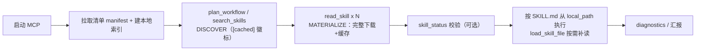

# codex-skills-mcp

> 🧠 Codex-Skills 技能库的 MCP (Model Context Protocol) Server — 让 AI 编程工具检索、阅读和使用持续更新的专业技能库。

## 这是什么

一个独立的 MCP Server，为 [codexproject 技能源](https://github.com/Zhan-ZhangZ/codexprojec/tree/main/codex-skills)提供标准化的 AI 工具接入协议。

- **无需先下载全部技能文件**：启动只拉取轻量清单，技能全文按需加载（beta.5 源清单约 245 KiB）；
- **技能与分类持续更新**：目录数量以实时清单为准，内容按需获取；
- **内置国内网络加速**：自动回退链，国内网络免翻墙可用。

| 特性 | 说明 |
|------|------|
| **8 个 Agent 核心工具** | search_skills, read_skill, load_skill_file, list_skill_files, list_categories, plan_workflow, skill_status, diagnostics |
| **Agent 行为合约** | server instructions + 工具描述 + 返回体尾部三层强化同一套 5 步工作流（见 [docs/AGENT-PROTOCOL.md](docs/AGENT-PROTOCOL.md)） |
| **缓存状态可见** | search/plan 结果带 `[cached]` 徽标；read_skill 返回 `local_path`；skill_status 深度校验完整性 |
| **活动日志与诊断** | 全部工具调用/下载/错误落 JSONL 日志；diagnostics 一键审计 |
| **三层渐进加载** | 检索(~500 tokens) → 阅读(~5K tokens) → 深入(按需) |
| **中文搜索优化** | CJK bigram 分词 + Leading Words 权重 |
| **零外部 AI 依赖** | 纯关键词搜索，不需要 embedding 模型 |
| **双传输模式** | stdio（本地）+ HTTP（远程） |
| **自动网络加速** | 官方加速端点优先，延迟加入 GitHub / CDN / 公共镜像竞速；完整正文通过校验后才接受 |
| **增量缓存** | 技能文件按大小比对断点续传，重复使用不重复下载 |

## beta.8 首页视觉与个人化工作台（尚未发布）

当前源码版本为 **1.5.0-beta.8**，插件版本为 **0.5.0**；npm 的 `beta` 仍为已发布的 beta.6。

- App 首页重做为本地优先的深蓝技能工作台，顶部融合合塑研工标识，底部展示出品方、来源与许可证说明；短页面页脚固定在视口底部，长页面仍位于正文末尾，标题、搜索区和内容区在桌面与窄屏都保留明确留白。
- 首页技能总数与领域数量直接由当前服务端清单计算，插件市场文案不再写死技能数量；源库增删技能后无需改前端代码。
- “常用技能”按真实读取次数排序并显示最近使用时间，没有记录时明确标注“尚未调用”；详情页可二次确认清除单个远程技能缓存，本地源目录不会暴露删除入口。
- 使用说明里的相对 Markdown 链接不再让 App iframe 直接跳走：包内文件切到文件页并打开预览，根目录 `SKILL.md` 回到全库大管家并显示“全局入口”，外部链接使用新窗口。
- 文件页支持 PNG、JPEG、GIF、WebP、BMP、ICO、AVIF 图片内联预览；单张上限 8 MiB，Office、压缩包等其他二进制仍显示类型、大小和本地路径。
- 新增固定模拟宿主的 Chrome 渲染预览，覆盖首页、详情、文件、子技能和窄屏布局，并检查危险 HTML/链接清洗；视觉验收记录见 [beta.8 审查记录](docs/BETA-8-REVIEW.md)。

## beta.7 可视化技能工作台（基础开发版）

- App 技能详情升级为“使用说明 / 文件 / 子技能”三个页签；文件可进入目录、预览内容、复制路径，子技能支持全量检索和分页。
- 使用说明默认安全渲染 Markdown（标题、列表、表格、代码块），并可一键切回逐字原文；恶意 HTML 和 `javascript:` 链接会被清洗。
- App 搜索显示已加载/总结果数，并通过现有 `skills.query` 的 offset 继续加载，不再只停留在前 24 项。
- 详情页直接显示完整缓存、部分缓存、未缓存和缓存版本待验证状态；快速切换页签时旧请求不能覆盖新内容。
- 首次读取大型技能时显示醒目的下载面板，包括百分比、进度条和 `已下载/总文件数`；切换技能后旧进度不会串到新详情页。
- 资源预览保持完整技能物化，读取说明时跳过未使用的目录和依赖扫描。
- 完整读取复用同次物化的检查结果，远端目录由已验证文件清单构建；子技能说明采用有界异步读取和摘要缓存，本地编辑模式保持实时扫描。
- 清单使用 GitHub raw 与 Contents API 两条权威通道；已有合法同源缓存时，权威刷新失败保留缓存，避免被旧镜像覆盖。
- 文件镜像短期复用通过完整性校验的获胜节点，同时保持原节点的启动时间；故障立即切换，`--no-hedge` 保留全量竞速。
- 可复现热读和公网 A/B 基准见 [beta.6 审查记录](docs/BETA-6-REVIEW.md)。
- `read_skill` 保留完整根说明，目录/子技能使用 12 KiB 有界导航；`list_skill_files` 支持全量检索、分页和签名 cursor。Journal 真实 stdio 结果约 2.07 MB → 20 KB，热读 273 → 209 ms。
- 文件、元数据和 manifest 共享默认 88 路进程级 HTTP admission（数据上限 80、manifest 保留 4），跨技能公平排队且完整覆盖 body 读取与校验。

## beta.5 改进（2026-10-16）

已发布版本为 **1.5.0-beta.5**，需要 **Node.js 22+**，通过 npm 的 `beta` 预发布通道分发。本版新增源仓库 immutable file catalog 联动。审计依据见 [BETA-5 审查记录](docs/BETA-5-REVIEW.md)，beta.4 服务端优化见 [BETA-4 审查记录](docs/BETA-4-REVIEW.md)。

体验预发布版本：`npx -y codex-skills-mcp@beta`；正式通道仍使用 `@latest`。

- 搜索立即读取本地索引，后台轮询更新；`force_refresh=true` 明确等待刷新。索引重复刷新不再累积评分统计。
- 下载校验完整正文、大小及 Git blob SHA；刷新失败保留可用缓存，断网时可使用合法同源清单启动。
- App 完成宿主初始化握手，修复搜索/详情竞态、返回导航、原地重试及输入法体验。
- HTTP 增加会话容量、正确的 404/400 语义、关闭清理及 Host/Origin 校验；默认监听 `127.0.0.1`。
- 源仓库 manifest 可携带不可变 `file_index`；MCP 优先读取 SHA-256 catalog 并并发下载文件，消除常规冷下载的 GitHub Tree API 依赖，旧清单自动回退。
- 新 catalog 立即触发版本更新；中断恢复校验已有文件 SHA，保留脚本执行位。兜底版本未通过当前 catalog 校验时明确展示状态；已知 SHA 的更新走校验后的镜像竞速。
- 离线回归、前端类型检查、包内文件和真实 stdio 协议验收接入 CI。

## 快速开始

### 1. 远程模式（默认，零配置，推荐）

```bash
npx -y codex-skills-mcp@latest
```

无需安装、无需指定任何路径。启动后自动完成：

1. 从远端技能库拉取清单 `skills_manifest.json`（本地缓存，按配置检查更新）；
2. 建立本地搜索索引（毫秒级）；
3. 技能文件按需下载，缓存在 `~/.codex-skills-cache/`（可用 `--cache-dir` / `CODEX_SKILLS_CACHE_DIR` 覆盖）。

### 2. 本地模式（可选）

适用于离线开发或使用本地技能库副本：

```bash
cd codex-skills-mcp
npm install
npm run build
node dist/index.js --skills-dir /path/to/codex-skills
```

### 3. HTTP 模式（远程客户端）

```bash
# 远程模式：无需 --skills-dir，自动拉取远端技能库
node dist/index.js --http --port 3456

# 本地模式：加 --skills-dir 指定本地技能库
node dist/index.js --skills-dir /path/to/codex-skills --http --port 3456
```

启动后：

- MCP 端点：`http://localhost:3456/mcp`（POST / GET / DELETE，支持 `mcp-session-id` 会话管理）
- 健康检查：`http://localhost:3456/health`

默认只监听 `127.0.0.1`。局域网/容器部署可显式设置 `--host 0.0.0.0`，并通过 `--allowed-hosts localhost,127.0.0.1,skills.example.com` 配置 Host/Origin 白名单。隧道保留远端 Host 时也需加入对应域名。

```bash
curl http://localhost:3456/health
# 示例输出；版本和技能数量由实际服务决定
{"status":"ok","name":"codex-skills-mcp","version":"1.5.0-beta.8","skills":291}
```

## 客户端配置

### Codex / ChatGPT 桌面端（stdio）

**方式一：通过 CLI 快速添加（推荐）**

```bash
codex mcp add codex-skills -- npx -y codex-skills-mcp@latest
```

**方式二：编辑 `~/.codex/config.toml` 添加**

```toml
[mcp_servers.codex-skills]
command = "npx"
args = ["-y", "codex-skills-mcp@latest"]
```

若使用本地技能库副本，可改为：

```toml
[mcp_servers.codex-skills]
command = "node"
args = ["/path/to/codex-skills-mcp/dist/index.js", "--skills-dir", "/path/to/codex-skills"]
```

### Claude Desktop

编辑 `~/Library/Application Support/Claude/claude_desktop_config.json`：

```json
{
  "mcpServers": {
    "codex-skills": {
      "command": "npx",
      "args": ["-y", "codex-skills-mcp@latest"]
    }
  }
}
```

### Cursor

编辑项目根目录 `.cursor/mcp.json`：

```json
{
  "mcpServers": {
    "codex-skills": {
      "command": "npx",
      "args": ["-y", "codex-skills-mcp@latest"]
    }
  }
}
```

### Windsurf / VS Code + Copilot

在 MCP 配置中添加同样的 command + args（stdio 模式）。

### 远程 HTTP 客户端

如果你的客户端需要以远程 HTTP 地址接入 MCP（例如 ChatGPT 桌面端集成场景）：

```bash
node dist/index.js --http --port 3456
ngrok http 3456
```

将 `https://xxxx-xxxx.ngrok-free.app/mcp` 填入客户端的 MCP Server URL。

> 💡 ngrok 免费版每次重启会更换地址；需要固定地址可使用付费版或其他隧道工具（如 Cloudflare Tunnel）。

## 工作原理



| 阶段 | 行为 | 耗时 |
|------|------|------|
| 启动 | 拉取/加载清单 + 建索引 | 秒级 |
| 搜索 | 本地索引关键词打分 | 毫秒级 |
| 取技能 | 优先读取静态 catalog → 并发下载并校验缺失文件；旧清单才回退 GitHub API | 首次数秒，之后走缓存 |

### 网络加速（并发竞速）

技能文件默认立即尝试官方加速端点，400ms 后启动其余节点；最近五分钟内经完整性校验的获胜节点也可立即启动，减少它在后续文件上的等待。实际故障立即触发后备节点。已知文件的完整响应体通过大小和 Git blob SHA 校验后才可胜出；清单更新优先读取 GitHub 权威源。关闭官方端点或使用 `--no-hedge` 时，所有启用节点立即竞速：

1. **官方加速端点** `gh.251716.xyz`（自建于香港的 raw.githubusercontent.com 只读反向代理，大陆方向 RTT 最低，小文件场景最快）；
2. **GitHub 官方直连**；
3. **jsDelivr CDN**；
4. **gh-proxy.com**；
5. **ghfast.top**。

单个节点失败后会切换到其他节点；延迟取决于网络和后备节点状态。获胜节点复用有助于减少重复尝试，慢响应时仍可能启动全部节点。

#### 官方加速端点披露

- **是什么**：`gh.251716.xyz` 是本项目自建的只读反向代理，用于改善中国大陆无代理环境下访问 GitHub raw 的速度。
- **凭证说明**：GitHub token（`--github-token` / `GITHUB_TOKEN` / 自动检测的 git 凭据）只发送给 GitHub 官方 API 与 raw 地址。官方加速端点、CDN 和公共镜像均不接收 Authorization。
- **如何关闭**：启动参数加 `--no-official-mirror`。
- **服务端日志**：命中官方端点的下载会在 stderr 输出 `official endpoint won: <文件名>`，便于观测命中率。

### Agent 标准工作流（行为合约）

服务端通过 initialize instructions、工具描述、返回体尾部三层向 Agent 强化同一套协议（措辞单点维护于 `src/lib/protocol.ts`）：

1. **DISCOVER** — `plan_workflow` / `search_skills` 检索；`[cached]` 徽标 = 已在本地，分数相近优先选；
2. **SELECT** — 选出覆盖任务的最小技能组合；
3. **MATERIALIZE（必做）** — 对每个选定技能调用 `read_skill`，完整下载到本地并返回 `local_path`；
4. **EXECUTE** — 严格按 SKILL.md 执行，脚本从 `local_path` 运行，禁止凭通用知识自行替代；
5. **VERIFY & REPORT** — `skill_status` 校验缓存完整性；`diagnostics` 排障并审计。

### 日志与诊断

- 活动日志：`~/.codex-skills-cache/logs/mcp-activity-YYYY-MM-DD.jsonl`（按天分文件，保留 14 天，best-effort 不影响主流程）；
- 记录事件：`tool_call` / `tool_result` / `download_skill_start` / `download_skill_complete` / `tool_error` / `server_start`；
- `diagnostics` 工具返回：近期调用、近期错误、缓存统计（已缓存技能数/体积）、清单新鲜度与配置摘要；
- 本地模式（`--skills-dir`）不写文件日志，仅镜像到 stderr。

### 缓存与增量同步

- 清单与技能文件缓存在 `~/.codex-skills-cache/`，二次启动秒级完成；
- 每个技能带 `.codex-skills.tree.json` 标记（文件列表 + 完成状态）；
- 已完整下载的技能直接本地读取，不重复请求远端；
- 完成缓存热读核对文件存在、大小和执行位；中断恢复还会校验已有文件的 Git blob SHA，再决定哪些文件需要重下；
- 技能文件并发下载，默认 16（可用 `--download-concurrency` 调整）；
- 清单可通过 `search_skills(..., force_refresh=true)` 或 `refresh_skills_list` 立即刷新；技能内容在 TTL 到期后的下一次读取时重验证。刷新失败保留原来的完整文件。
- 远端完整缓存的目录和子技能列表描述已登记的源文件；手动放入缓存目录的额外文件、子技能和空目录不进入列表。需要实时发现本地新增内容时使用 `--skills-dir`。已有登记文件的本地编辑仍使摘要缓存失效。
- 清单 raw 请求立即发出，Contents API 在 800ms 后或 raw 明确失败时加入；共用启动 20s、后台轮询 4s 的权威请求预算。有效同源缓存只接受权威更新；没有有效缓存时保留镜像引导兼容，镜像新鲜度不作保证。

## MCP Tools

### 🔍 search_skills

搜索技能库，Agent 的主入口（协议 STEP 1）。结果带 `[cached]` 徽标与"下一步必须 read_skill 物化"的协议尾部。

```
input:  { query: "前端性能优化", category?: "01_代码工程与架构", limit?: 8 }
output: 按相关度排序的技能列表（名称、分类、分数、描述）
```

### 📋 list_categories

列出所有技能分类和数量。

```
input:  {}
output: 14 个分类 + 各自的技能数量
```

### 📖 read_skill

物化技能（协议 STEP 3，执行前必调）：完整下载技能目录到本地缓存（已缓存则秒回），原样返回根 `SKILL.md` 指令 + 依赖 + **Cache & Execution 段（local_path / 完整性 / setup 命令）**，目录和子技能给有界导航预览。

```
input:  { name: "MediaCrawler" }
output: { instructions, dependencies, navigation: { files, sub_skills } }
```

### 📂 load_skill_file

按需读取技能内的任意文件。

```
input:  { skill_name: "KrillinAI", file_path: "README.md", offset?: 0, max_bytes?: 524288 }
output: { content, size_bytes, offset, bytes_returned, next_offset?, has_more, binary }
```

> 小文件一次返回完整内容；大文本按 UTF-8 字节边界分段，每次默认 500 KiB，最大 2 MiB。继续读取时传入返回的 `next_offset`。二进制文件返回占位说明；路径穿越会自动拦截。

> Office 文档（Word/Excel/PowerPoint）、压缩包、图片、音视频、数据库等按二进制处理，不展示内部字节；App 会提示 MIME 类型并允许复制缓存中的完整路径。

### 🗂️ list_skill_files

浏览技能的文件树或搜索全部嵌套子技能（不重复根说明）。

```
input:  { skill_name, view?: "files" | "sub_skills", path?, max_depth?, query?, limit?, cursor? }
output: 有界页面 + matched/total/next_cursor 元数据
```

### 🔗 plan_workflow

给定任务描述，产出可组合技能的**有序执行计划草稿**（带 `[cached]` 徽标），并强制"先 read_skill 全部选定技能再开工"。

```
input:  { task_description: "把技术博客做成小红书图文" }
output: 推荐技能列表 + 分类分组
```

### ✅ skill_status

深度校验一个或多个技能的本地缓存完整性（逐文件大小核对，只读不下载）。

```
input:  { names: "KrillinAI, videocut-skills" }
output: cached/complete/local_path/files_total/files_missing/completed_at
```

### 🩺 diagnostics

审计与排障：近期工具调用、近期错误（活动日志）、缓存统计、清单新鲜度、配置摘要。

```
input:  { include_log?: true, log_lines?: 20 }
output: Server / Manifest / Local skill cache / Recent errors / Recent tool calls
```

## OpenAI MCP Extensions（ChatGPT 原生集成 · Phase 1）

基于 [openai/mcp-extensions](https://github.com/openai/mcp-extensions) 规范与官方 SDK 新增，详见 [docs/OPENAI-MCP-EXTENSIONS.md](docs/OPENAI-MCP-EXTENSIONS.md)：

- **⚙️ `settings.read` / `settings.update`** — ChatGPT 插件详情页的原生设置面板（开关/数字控件）。配置项热生效、原子持久化到 `~/.codex-skills-mcp/settings.json`、重启后自动恢复。
- **🔄 `refresh_skills_list`** — 设置页按钮型动作：立即刷新远端技能清单。
- **💬 `search_mentions`** — ChatGPT composer 里 `@技能库` 直接 typeahead 搜索技能（对模型隐藏，仅宿主调用；Codex CLI 实测符合规范）。
- **📄 `skill://{name}` 资源** — 提及的技能引用经 `resources/read` 解析为 SKILL.md（首读即物化），同时是后续官方 `io.modelcontextprotocol/skills` 扩展的 groundwork。

> 兼容性：全部通过 MCP 标准扩展点（`_meta` / capability）实现，非 ChatGPT 宿主（Codex/Claude/Cursor 等）自动忽略，8 个核心工具行为零变化（回归测试覆盖）。

## 使用流程（示例）

```
用户: "帮我把这个视频翻译成中文字幕"

Agent → plan_workflow("把视频翻译成中文字幕")          # DISCOVER：拿到组合计划
Agent → search_skills("视频字幕翻译")                   # DISCOVER：精确定位
     → 命中: KrillinAI, videocut-skills, VideoClaw      # [cached] 徽标优先

Agent → read_skill("KrillinAI")                         # MATERIALIZE：完整下载
     → 返回 SKILL.md + local_path + 依赖
Agent → read_skill("videocut-skills")                   # 每个选定技能都要物化

Agent → skill_status("KrillinAI, videocut-skills")      # VERIFY：确认缓存完整

Agent → 按 SKILL.md 从 local_path 执行任务               # EXECUTE：严格遵循指令
     → 需要补充文件时 load_skill_file(...)
```

## 配置参考

| 参数 | 默认值 | 说明 |
|------|--------|------|
| `--skills-dir <path>` | - | 本地技能库目录（指定后进入本地模式） |
| `--local` | - | 强制本地模式（从 cwd 或 `--skills-dir` 查找清单） |
| `--github-repo` | `Zhan-ZhangZ/codexprojec` | 远端技能库仓库 |
| `--github-branch` | `main` | 远端分支 |
| `--github-path` | `codex-skills` | 技能库在仓库内的目录 |
| `--github-token` | 自动从 git 凭据 / `GITHUB_TOKEN` 获取 | GitHub API 鉴权 |
| `--http` | - | 启动 HTTP 模式 |
| `--host` | `127.0.0.1` | HTTP 监听地址 |
| `--allowed-hosts` | 本地主机白名单 | HTTP 允许的 Host/Origin 主机名，逗号分隔 |
| `--port` | `3456` | HTTP 端口，0–65535；0 自动选择空闲端口 |
| `--cache-dir` | `~/.codex-skills-cache` | 缓存目录，也可用 `CODEX_SKILLS_CACHE_DIR` |
| `--download-concurrency` | `16` | 技能文件并发下载数，1–64 |
| `--download-timeout` | `30` | 请求/单轮镜像竞速超时秒数，1–300，覆盖完整正文；大文件自动延长，blob 回退单独计时 |
| `--soft-deadline-seconds` | `55` | 无 progress token 请求的响应期限；0 禁用 |
| `--hard-deadline-seconds` | `285` | 所有下载调用的响应期限；0 禁用 |
| `--no-official-mirror` | 关闭 | 禁用官方加速端点 |
| `--no-hedge` | 关闭 | 所有节点立即开始竞速 |
| `--manifest-ttl <秒>` | `86400` | 清单缓存 TTL（0 = 永不按年龄刷新）。新技能可见性由下面的轮询负责 |
| `--manifest-poll <秒>` | `300` | 后台清单轮询间隔：search/plan/mentions/App 调用触发节流检查；完成后后续请求使用新索引。0 = 关闭，范围 0–3600 |

环境变量：`CODEX_SKILLS_DIR`、`CODEX_SKILLS_CACHE_DIR`、`GITHUB_TOKEN`、`CODEX_SKILLS_DOWNLOAD_CONCURRENCY`、`CODEX_SKILLS_DOWNLOAD_TIMEOUT`、`CODEX_SKILLS_MANIFEST_POLL_SECONDS`。设置文件默认位于 `~/.codex-skills-mcp/settings.json`，可通过 `CODEX_SKILLS_SETTINGS_DIR` 隔离。CLI 显式参数优先于启动时保存的设置；设置面板更新实时同步各会话。

技能库清单（`skills_manifest.json`）为 JSON 数组，每项包含 `name` / `description` / `category` / `folder` / `relative_path` 五个必需字段。较新清单还会为非根技能提供 `file_index`，指向不可变 catalog 及其 SHA-256。

## 常见问题

| 问题 | 处理 |
|------|------|
| Agent 读了 SKILL.md 却不按指令执行 | v1.4.0 起三层合约强制 5 步协议；仍异常时用 `diagnostics` 审计该 Agent 实际调用序列 |
| 想看 Agent 到底做了什么 | `diagnostics` 或直接读 `~/.codex-skills-cache/logs/mcp-activity-*.jsonl` |
| npx 首次运行较慢 | 首次需下载 npm 包 + 拉取清单，属正常；之后走缓存 |
| 日志出现 `Network warning` | 当前加速节点失败，自动降级到下一个，可忽略 |
| 想更新技能内容 | 使用 `--manifest-ttl 60`，到期后重新读取技能会按远端文件树重验证；失败时保留原缓存 |
| 仓库新增了技能但搜不到 | 普通搜索先返回现有索引，后台检查更新；立即获取可用 `search_skills(query, force_refresh=true)` 或设置面板的刷新动作 |
| `load_skill_file` 读到文件的一部分 | 大文本按字节分段；使用返回的 `next_offset` 继续读取 |
| GitHub API 限流 | 每个技能仅 2 次 API 调用，已缓存技能不再请求；未登录配额 60 次/小时 |
| 工具列表里看不到 MCP | 客户端未重启，重启会话即可 |

## 技术栈

- TypeScript + ESM
- `@modelcontextprotocol/sdk` v1.30+
- `express` v5（仅 HTTP 模式）
- `zod` v4 运行时 schema 验证
- Node.js 22+

## 开发与验收

```bash
npm ci
npm test                  # 前后端类型检查、构建、离线回归
npm run benchmark         # 固定双语样本搜索基准
npm run build:plugin       # 从源码重新构建插件
npm run check:package      # npm 压缩包 + 插件的 stdio 端到端验收
npm audit
```

测试使用临时目录、模拟网络或本地随机端口。旧测试文件保留为兼容入口，统一转发到新的离线套件。CI 配置覆盖 Node 22 / 24。

## License

MIT
