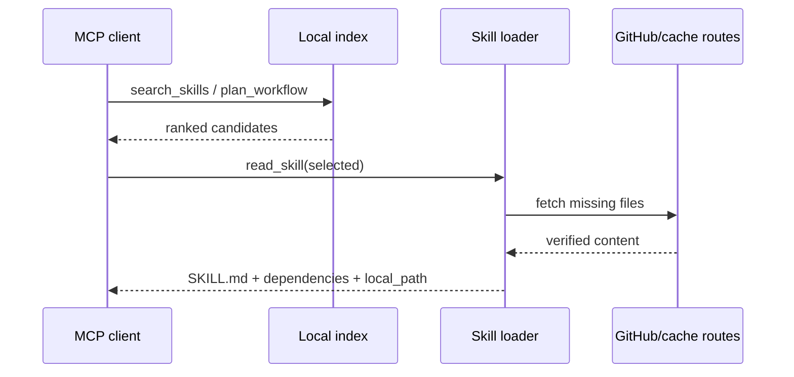

# Architecture

## Design goals

1. Keep the model context small until a skill is actually selected.
2. Treat remote content as untrusted until size and Git blob identity match.
3. Preserve a usable offline cache when a refresh fails.
4. Keep standard MCP clients on a focused tool surface while enabling richer
   MCP Apps hosts.

## Runtime components

| Component | Responsibility |
|---|---|
| `src/config.ts` | CLI/environment parsing, transport mode and precedence |
| `src/index.ts` | Server construction, tool profiles and transport startup |
| `src/search/` | Manifest indexing, keyword/task ranking and usage signals |
| `src/remote/` | Manifest refresh, GitHub reads, integrity checks and route racing |
| `src/loader/` | Skill materialization, file reads and cache state |
| `src/tools/` | Core MCP tool contracts |
| `src/openai/` | Settings, mentions, resources and MCP App bridge |
| `src/lib/` | HTTP server, navigation, deadlines, logging and protocol text |
| `app-src/` | Interactive MCP App source |

## Request flow

`search_skills` does not trigger a full skill download. `read_skill` and
`load_skill_file` are the materialization boundary.

## Manifest and cache

The remote source provides `skills_manifest.json`. The server caches it, builds
a local BM25-style index, and periodically checks freshness. A newer immutable
catalog may identify exact file names, sizes and Git blob SHAs, allowing direct
parallel downloads. Older manifests fall back to the GitHub tree API.

The skill cache is a real directory tree with a completion marker. A partial
download remains resumable. A complete entry is served locally on subsequent
reads and may be revalidated after the configured TTL.

## Network routes

The raw-content route set can include:

1. official CN read-only mirror;
2. GitHub raw;
3. jsDelivr;
4. gh-proxy.com;
5. ghfast.top.

The default scheduler starts the primary route and introduces hedging after a
short delay. A recently verified route can be reused, and explicit failures may
start the remaining routes immediately. Every winning file body is verified
before the route is remembered.

The manifest itself prefers authoritative GitHub raw and Contents API paths.
Mirrored manifest data is not allowed to silently replace a validated
same-source cache.

## Concurrency and deadlines

The process has a shared HTTP admission budget. File, metadata and manifest
requests use separate capacity classes so one large skill cannot starve catalog
refresh. Download calls have:

- a soft deadline that returns structured progress before common client
  timeouts;
- a hard deadline that bounds pathological network operations.

Background work may continue after a partial response, and a retry resumes from
verified cache files.

## Security boundaries

- Remote paths are validated and constrained to skill roots.
- Symlink traversal and adjacent-prefix directory escapes are rejected.
- Markdown rendered by the App is sanitized; unsafe tags and attributes are
  removed.
- HTTP mode validates Host/Origin and binds locally by default.
- Skill content and third-party dependencies retain their own licenses.

See [SECURITY.md](../SECURITY.md) for reporting and operational guidance.
