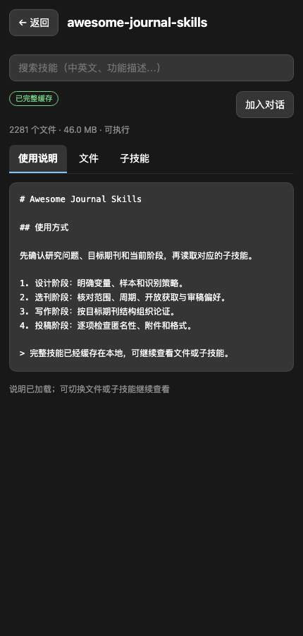
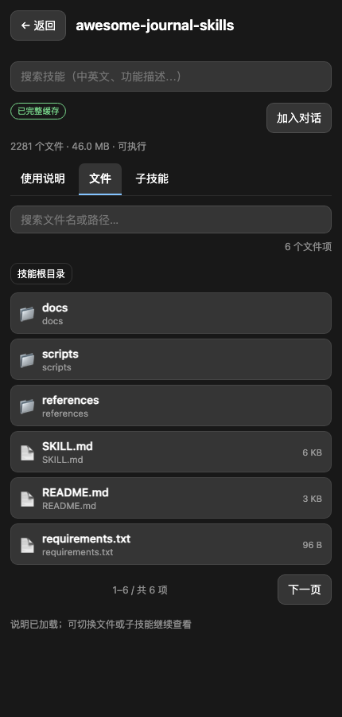
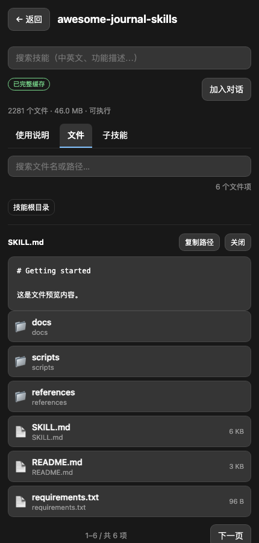
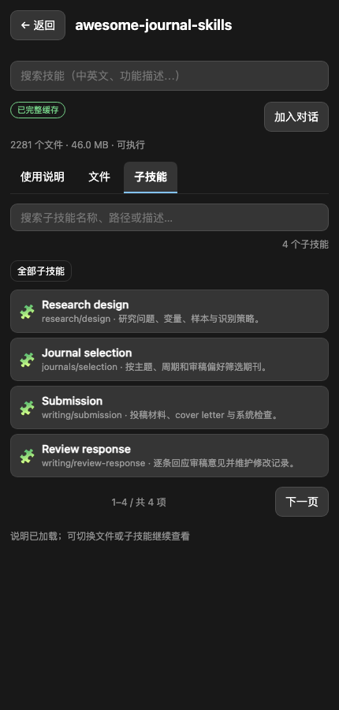

# beta.7 可视化技能工作台

日期：2026-10-17。开发版本 `1.5.0-beta.7`，插件 `0.4.0`。本记录不代表 npm 已发布。

beta.6 解决了 Agent 读取大技能时的输出、分页和并发问题。beta.7 把同一套能力接到用户可见的 MCP App：用户可以在一个详情页里阅读完整根说明、浏览文件和嵌套子技能，并明确看到缓存状态。

## 详情页

- “使用说明 / 文件 / 子技能”三个页签共享同一个技能上下文，切换页签不会重新介绍技能。
- 根说明最多展示 200,000 字符，足以覆盖当前源库最大约 64KB 的 `SKILL.md`；来源内容仍由服务端原样返回。
- 文件页支持目录面包屑、文件名/路径检索、每页 50 项和前后翻页；文件可直接预览并复制完整路径。
- 子技能页检索全部嵌套名称、路径和完整描述；点击子技能会打开对应 `SKILL.md` 的预览。
- 页面使用有界 DOM：每次只渲染当前页，不把数千个文件或子技能一次放入界面。

## 缓存与错误状态

| 状态 | 用户看到的信息 |
|---|---|
| 完整 | 已完整缓存、文件数、体积、可执行 |
| 部分 | 部分缓存、缺失文件数 |
| 未缓存 | 读取说明时会下载完整技能 |
| 缓存版本待验证 | 当前是旧缓存，联网重试后才能确认源版本 |

详情读取成功后立即显示“已完整缓存”，随后用深度状态检查补上文件统计。先发出的未完成状态不能覆盖后发出的完整状态。切换技能、页签、路径或文件时，旧请求结果会被身份检查丢弃；慢文件不能被后点击的文件覆盖。

## 结构化协议

- `list_skill_files.structuredContent` 新增当前页 `entries`，每项包含名称、完整路径、类型、描述、大小和显示文本。
- `skill_status.structuredContent` 新增每个技能的 `cached/complete/catalog_current/files_total/files_missing_count/size_bytes/completed_at`。
- 原有文本响应保持不变，纯文本客户端继续兼容；工具总数仍为 16，没有为浏览 UI 增加新工具。

## 可视化验收

`scripts/preview-mcp-app.mjs` 启动一个确定性的模拟 MCP 宿主，用本机 Chrome DevTools Protocol 等待页面到达指定状态后截图。它覆盖浅色/深色宿主变量、详情、文件、子技能和文件预览页面，不依赖真实网络。









宽屏文件页见 `benchmarks/app-preview-files-wide.png`。渲染检查修复了 430px 宽度下工具栏按钮溢出，以及长文件列表把预览区推到页面底部的问题。

运行：

```bash
npm run build:app
node scripts/preview-mcp-app.mjs --state files --output /tmp/app.png
```

## 验证

- MCP 全量回归 **241/241** 通过。
- App 重点覆盖：初始化、主题、搜索 IME、详情与附件竞争、缓存状态竞争、文件目录/预览、子技能检索/翻页、旧请求失效。
- npm 包和插件产物在本轮发布前仍需重新执行 `check:package`。
- 固定 Chrome 渲染已检查 430px 与 1180px 布局；真实 ChatGPT 宿主内的最终视觉验收仍需在发布前完成。

## 边界

- 超过 500 KiB 的辅助文件仍由 `load_skill_file` 拒绝，界面会显示可重试的错误；显式 chunk/range 读取留到后续版本。
- 当前分页按钮只支持相邻前进/后退，搜索或路径变化会回到第一页；这是有意保持页面状态简单。
- 插件与 npm 包尚未发布，不能把本地截图当作宿主验收或发布证明。
