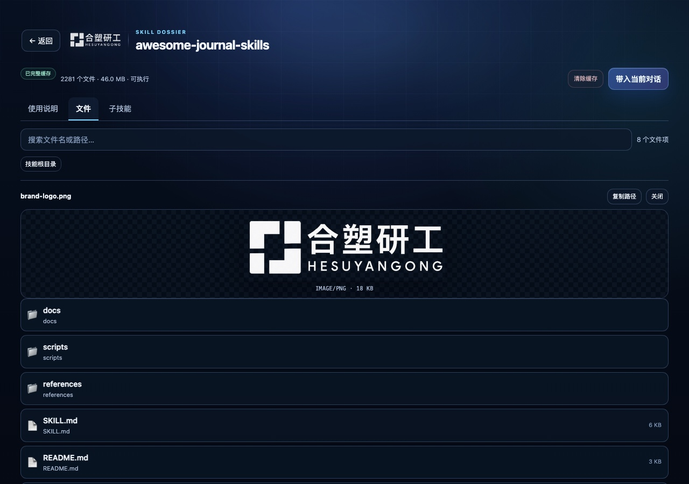
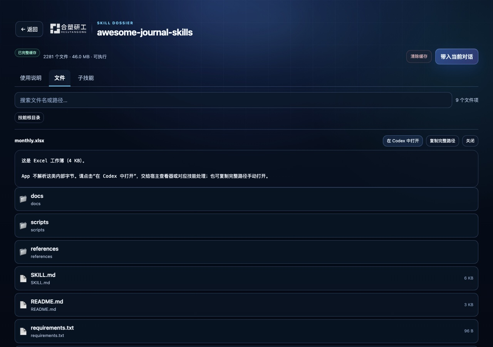
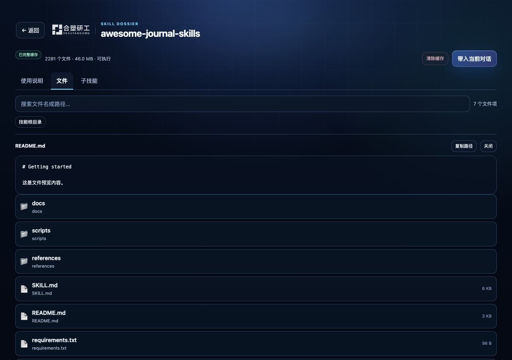
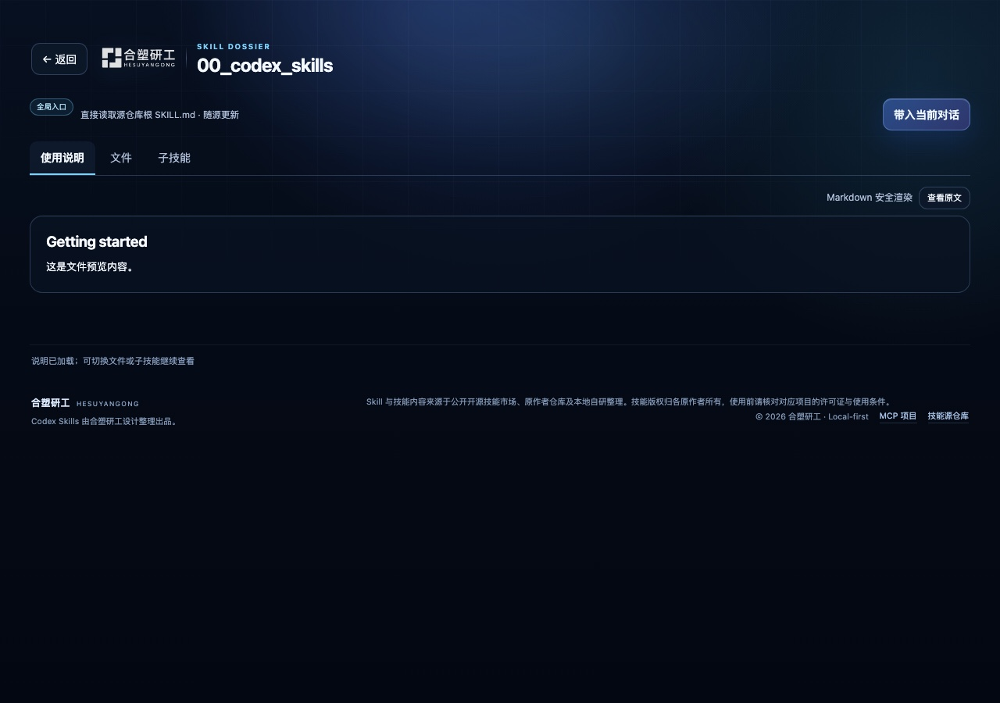
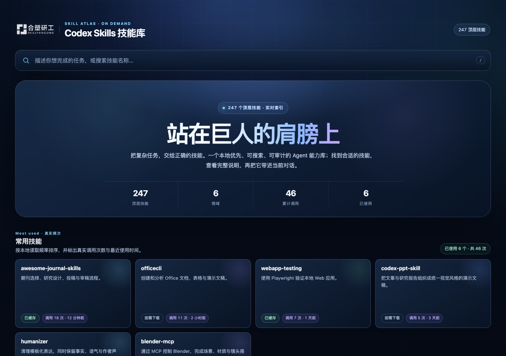
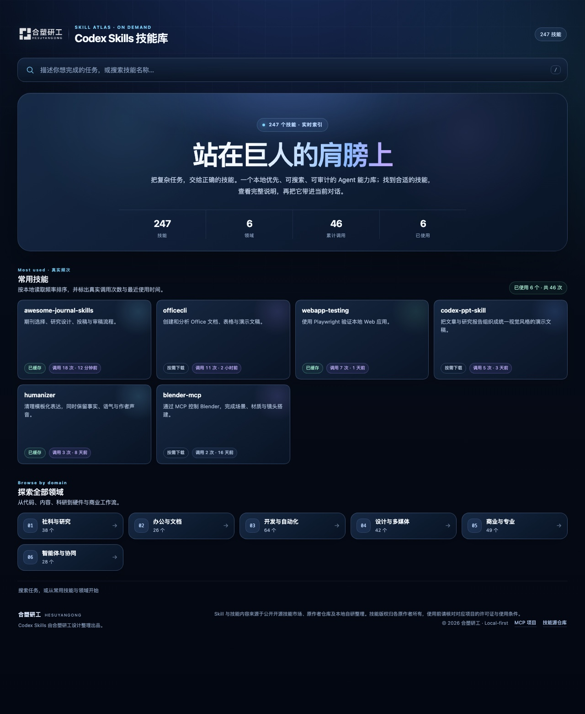

# beta.8 首页视觉与个人化工作台

日期：2026-10-18。开发版本 `1.5.0-beta.8`，插件 `0.5.0`。本记录不代表 npm 已发布。

beta.8 在 beta.7 的三页签技能详情之上，完成用户每天首先看到的首页、品牌身份、真实使用排序和单技能缓存管理。MCP 工具协议、下载调度与缓存完整性校验沿用 beta.7。

## 首页与品牌

- 顶部使用克制的合塑研工标识，与技能库标题组成同一身份区；桌面为 31px 高，窄屏为 27px，不抢占内容层级。
- 首页采用深蓝径向光、细网格、玻璃面板和克制的卡片动效，同时为 `prefers-reduced-motion` 提供静态降级。
- Hero 主标题使用“站在巨人的肩膀上”，原来的“把复杂任务，交给正确的技能”降为引导句，桌面与窄屏都保持单行主标题，不产生孤字换行。
- 页面使用纵向弹性布局：内容不足一屏时，状态栏与品牌来源页脚锚定在视口底部；内容超过一屏时自然落在长页面末尾，不覆盖正文。
- 顶层技能总数、领域数和各分类数量全部从当前 `skills.browse` 响应计算。页面没有固定技能总数；服务端重建清单索引后，下一次页面读取直接使用新的分类和数量。插件市场描述和 MCP server instructions 也不再携带固定数量。
- “常用技能”显示真实的累计读取次数、最近使用时间和失败次数提示。没有使用记录时改为“近期值得探索”，不把推荐排序伪装成调用次数。
- 页脚说明合塑研工设计整理出品，Skill 与技能内容来自公开开源技能市场、原作者仓库及本地自研整理，并保留原作者许可证提示与两个仓库入口。

## 缓存管理

远程缓存可通过详情页“清除缓存”按钮删除：第一次点击进入 4 秒确认态，第二次点击才执行。正在下载、本地源库模式、符号链接和非目录缓存都会拒绝删除。缓存目录删除后，清单和使用频次仍保留，下一次读取重新下载技能文件。

服务端新增 app-only `skills.clearCache` 与 `skills.previewImage`。前者只删除独立技能缓存，后者读取受支持的栅格图片；两者不会出现在模型工具列表中，当前工具总数为 19。本地源目录不会暴露删除入口。

## 图片文件预览

- 文件页识别 PNG、JPEG、GIF、WebP、BMP、ICO 与 AVIF，通过 app-only base64 通道在 App 内直接显示，不再只给出“请去本地路径打开”。
- 图片单张上限 8 MiB；超过上限和 SVG 等非栅格格式使用宿主交接或路径兜底。
- 图片区使用棋盘底、最大高度与等比缩放，桌面和 430px 窄屏都不会撑破文件页。

## 文件打开策略

MCP App 只内置轻量的浏览器原生预览，不承担通用 Office/PDF 解析器的体积和维护成本：

| 类型 | 处理 |
|---|---|
| 文本、源码、Markdown、JSON、CSV 等 | App 内直接显示，大文件按字节分段 |
| PNG、JPEG、GIF、WebP、BMP、ICO、AVIF | App 内图片预览 |
| DOCX、XLSX/XLSM、PPTX/PPSX、PDF | 显示文件类型、大小、缓存状态和完整路径；“在 Codex 中打开”调用宿主 `openai/files/open` |
| DOC、XLS、PPT、ODT/ODS/ODP、EPUB | 同样交接宿主，由宿主查看器或对应技能处理 |
| ZIP、7Z、RAR、TAR、GZ、XZ | 交接宿主；App 不展开不受信任的压缩包 |
| 音视频、字体、数据库、PSD、WASM、可执行文件等 | 交接宿主；无法打开时保留完整路径与复制按钮 |

宿主未提供文件打开能力或打开失败时，App 会显示失败原因并保留“复制完整路径”，不会把内容上传到第三方服务。这样 xlsx、docx 等格式由 Codex 原生能力处理，MCP 包不增加 Office/PDF 解析依赖。

## Markdown 文件链接

使用说明渲染后的相对链接现在由 App 自行接管，不再交给 iframe 直接导航：

- `./README.md`、`bilibili-transcribe/SKILL.md` 等包内目标会切到“文件”页并直接预览对应文件。
- `../../../SKILL.md` 这类指向全库根目录的目标会打开当前清单提供的大管家技能。
- `http://`、`https://` 与 `mailto:` 使用新窗口，并带 `noopener noreferrer`。
- 越出技能根目录的其他路径会被阻止，并给出状态提示，避免跳出到 404 或宿主错误页。

源库 290 份顶层 `SKILL.md` 中共发现 559 个相对本地链接，其中 558 个位于技能包内部。缺少点击拦截是跨技能通病；chubbyskills 同时包含包内 README 和指向全库大管家的链接，因此最先暴露。模拟宿主新增 `internal_link` 与 `butler_link` 两条真实 DOM 点击链路，已验证 README 会打开文件预览、全库根链接会请求 `skill://00_codex_skills`。

大管家来自源仓库根 `SKILL.md`，不是独立缓存目录。`skill_status` 将其返回为 `root=true`、`cacheable=false`；App 显示“全局入口”，不把缓存根目录误报为“技能不存在”，也不暴露清除缓存按钮。

## 实时数据

- 首页总数由服务端当前分类数组求和，不在前端写死。
- `popularSkills(limit)` 按成功读取次数、最近使用时间和源清单更新时间稳定排序。
- 使用记录新增 `lastReadAt`，兼容旧版纯数字计数格式；清除技能缓存不会清空使用历史。
- `skills.browse`、`skills.query` 与详情页同时返回读取次数、失败次数和最近使用时间。

## 视觉与响应式

固定 Chrome 模拟宿主新增入场动画结束等待，避免把半透明入场帧误判成最终颜色。已检查：

- 1280×900 桌面首页与详情页。
- 430×932 移动首页与详情页。
- 1280×1560 完整页脚与分类区域。
- 430×2700 移动端完整页面。
- 详情页空数量胶囊、移动端工具栏和长技能名换行。

预览夹具里的技能数量由分类数组实时求和，只用于稳定布局回归，不代表线上统计。

完整页脚与分类区域：

详情页内容较短时，页脚同样贴住视口底部：

## 验证

- MCP 全量回归 **266/266** 通过；Node 22 本地复跑同为 **266/266**。
- GitHub CI 的 Node 22/24 两个任务均通过；对应提交 `050162b`。
- npm tarball 与插件 bundle 的 stdio 冒烟均通过，产物工具数为 18。
- 真实远端清单冒烟：291 条 manifest、290 个可索引技能；`humanizer` 冷下载 9 个文件并完成 SHA/大小/执行位校验，热读不发网络请求。
- 构建后的 `dist/app.html` 与 `assets/app.html` SHA-256 一致。

## 边界

- 当前记录验证的是固定 Chrome 宿主和本地 stdio MCP；真实 ChatGPT MCP App 的最终视觉确认仍需重启 Codex 后由用户完成。
- npm `beta` 仍指向已发布的 beta.6；beta.7、beta.8 尚未发布。
