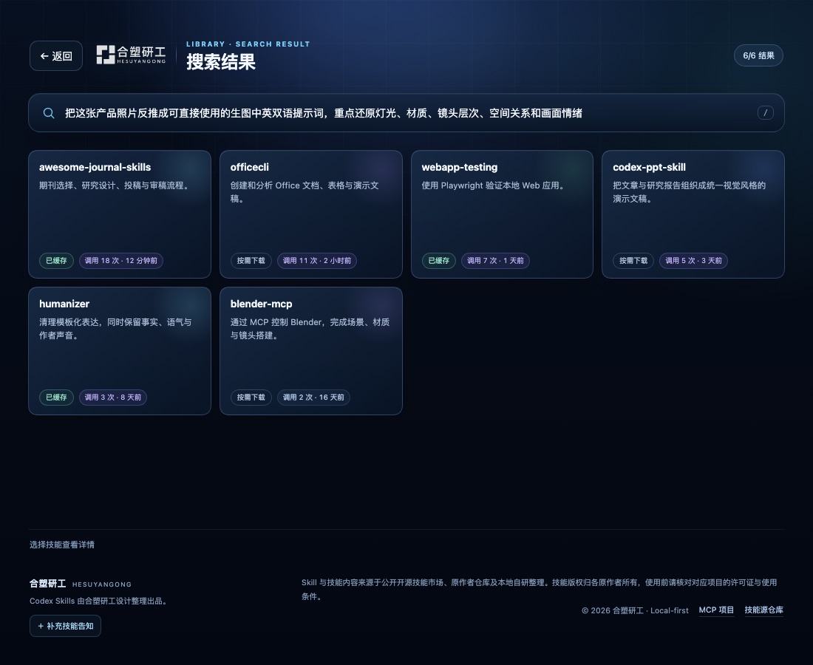

# beta.9 搜索历史与长文本搜索修复

日期：2026-10-19。开发版本 `1.5.0-beta.9`，插件 `0.6.0`。本记录不代表 npm 已发布。

## 搜索历史

- 搜索框下方新增“最近搜索”，保存最近 8 条非空查询。
- 历史写入本地 `localStorage`；浏览器或宿主禁止存储时，当前会话仍保留内存历史。
- 3 秒内连续输入会合并为最后一条完整查询，重复查询会移到最前，不产生重复 chip。
- 点击历史 chip 直接重新执行搜索；长查询只显示单行截断标签，完整文本保存在 `title` 和重新搜索参数中。
- “清除记录”同时清空内存状态和本地存储，面板立即收起。
- 详情页隐藏历史；首页与分类页展示，搜索结果页在输入框为空时才展示，避免挤压结果。


## 长文本搜索

搜索页顶部原来显示 `搜索“完整 query”`，复制超长文本后会把页面标题撑开。现在顶部固定显示“搜索结果”，完整 query 只保留在搜索输入框中，结果数量仍在右上角展示。



430px 窄屏下，搜索历史和长 query 输入框都保持单行边界，导航与结果卡片不被挤出视口。


## 验证

```bash
npm test
npm run build:plugin
node scripts/preview-mcp-app.mjs --state history --width 1100 --height 900
node scripts/preview-mcp-app.mjs --state search_long --width 1100 --height 900
node scripts/preview-mcp-app.mjs --state history --width 430 --height 900
```

- 全量自动回归 268/268 通过，包含搜索历史持久化、清除、长文本 chip 截断、顶部标题不再重复 query。
- `assets/app.html` 与 `plugin/dist/app.html` 已从同一份源码重新构建；`plugin/dist/server.js` 已重新打包。
- 固定宿主 Chrome 预览覆盖桌面历史、长 query 结果页和 430px 历史页，未发现遮挡、溢出或底部错位。
- 当前 Codex 侧边栏连接的是 npm 已发布的 `beta.8`，因此现场仍会显示旧 UI；发布 beta.9 或切换到本地构建并重启 MCP 后才加载本次界面。
